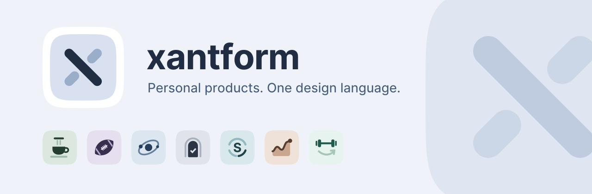

<strong>Personal products. One design language.</strong>

A collection of thoughtfully designed software experiences for everyday life, sports, training and personal information.

## The product family

| Product | Focus |
| --- | --- |
|  **Coffee Lab** · Private | Personal coffee intelligence for espresso, filter brewing and better experimentation. |
|  **NFL Pulse** · Private | NFL scores, playoff context, team insights and evidence-aware forecasts. |
|  **Henning Hub** · Private | A personal Android home for modules, spaces, routines and app navigation. |
|  **Henning App Control Center (HACC)** · Private | A protected, read-only overview of releases and repository health. |
|  **Stride** · Private | A native Garmin Forerunner 970 watchface focused on training metrics. |

### Open-source involvement

**[hevy2garmin](https://github.com/xantic21/hevy2garmin)** — a public fork of the [original community project by drkostas](https://github.com/drkostas/hevy2garmin), connecting Hevy workouts with Garmin Connect.

## What guides the work

| Design quality | Purposeful technology | Privacy and reliability |
| --- | --- | --- |
| Clear hierarchy, calm surfaces and One UI-inspired interactions. | Practical workflows instead of feature overload. | Local-first when possible, controlled releases and explicit evidence. |

## About this portfolio

The Android apps and watchface are currently private projects. This public profile describes their purpose without publishing private source code, credentials, release infrastructure or personal configuration.

---

xantic21 · Personal software portfolio · One UI-inspired visual identity · Not affiliated with Samsung Electronics
